# Fingerprinting LLM Families from Their Text with CNNs and RNNs

**DS340W — Midterm Project Report · Fall 2026**
**Team:** Jackson Gasperack, Sawan Pandita

---

## 1. Problem definition and dataset curation (20 pts)

Per the request of the project, we wanted to build out classification models using Reinforcement Learning through Neural Networks to classify an LLM family based on user input, AI response, and both input and output. To achieve this, we need to utilize datasets of text generated by various LLM families. The models we use will be a TextCNN and a BiLSTM.

### 1.1 Problem

Text written by large language models is everywhere, but it rarely says which model
produced it. It's very important to note differences and key on the specific behaviors that separate different LLM families as knowing the source matters for auditing purposes and it can help us further hone these models to produce more desirable outputs. We frame this as a **closed-set,
multi-class text classification** problem: given a piece of text, predict which of *K* = 6 LLM
families produced it.

Two complications shape the study:

1. **Self-identification is a shortcut.** Many responses contain phrases such as *"As an
   AI language model developed by OpenAI…"*. A classifier that keys on those strings is not
   learning anything interesting, so we remove them before training.
2. **Prompts may leak identity.** On a chatbot platform, people do not send the same prompts
   to every model, so the prompt alone might already reveal the model. Conversely, the prompt
   might add useful context to the response.

### 1.2 Research questions

| | Question |
|---|---|
| **RQ1** | With self-identification removed, how accurately can a CNN and a BiLSTM identify the LLM family from the **response alone**? |
| **RQ2** | Does the **prompt** leak model identity on its own, and does concatenating prompt + response improve on response-only classification? |
| **RQ3** *(extra)* | Do the classifiers learn model-wide fingerprints, or domain-specific patterns that fail to transfer across task categories? |
| **RQ4** *(extra)* | Is the signal mainly **structural** (markdown formatting) or **linguistic** (word choice)? |

### 1.3 Source data

We use **LMSYS-Chat-1M** (Zheng et al., 2023): one million real conversations collected from
the Vicuna demo and Chatbot Arena between April and August 2023, covering 25 models. Each
record has a conversation ID, the model name, the full conversation as a list of
`{role, content}` turns, a detected language, OpenAI moderation output per turn, and a flag
for PII redaction. Access is gated; `dataset_authorization.py` verifies the user's Hugging
Face credentials before `load_data.py` downloads the data.

### 1.4 Family definition

We group model versions into six families so each class reflects a vendor's style rather
than a single checkpoint:

| Family | Model versions in LMSYS-Chat-1M |
|---|---|
| GPT | gpt-3.5-turbo, gpt-4 |
| Claude | claude-1, claude-2, claude-instant-1 |
| LLaMA-2 | llama-2-7b-chat, llama-2-13b-chat |
| Vicuna | vicuna-7b, vicuna-13b, vicuna-33b |
| PaLM | palm-2 |
| MPT | mpt-7b-chat, mpt-30b-chat |

### 1.5 Curation pipeline (`data_cleaning.py`)

| Step | Rule | Why |
|---|---|---|
| Language | keep `language == "English"` | single tokenizer and vocabulary |
| Turn | first user prompt + first assistant reply | later turns depend on conversation history |
| Moderation | drop if either message was flagged | removes abusive / jailbreak content that is unrepresentative of normal behaviour |
| Length | response ≥ 5 words | very short replies ("Sure!") carry almost no signal |
| De-duplication | one response per (family, normalised prompt) | LMSYS users re-send the same test prompts; duplicates would leak across splits |
| Sampling | 4,000 random pairs per family (seed 42) | balanced classes, so accuracy and macro-F1 are directly interpretable (chance = 1/6) |
| Self-ID stripping | drop any sentence that names a model/vendor **and** refers to the speaker | removes the identity shortcut |
| Masking | replace remaining model/vendor names in prompts and responses with `[MODEL]` | removes residual name leakage (e.g. "Hi ChatGPT, …") |
| Task category | heuristic keyword rules → coding / math / creative / general | needed for RQ3 |

Each observation is stored as `(LLM_name, LLM_input, LLM_output)` plus the conversation ID,
model version, task category and the number of self-identification sentences removed
(`data/cleaned/lmsys_clean.csv`).

We deliberately **kept** generic disclaimers that name no model. They are a habit general to AI, not a statement of identity. So, removing them would cross over into style removal rather than de-identification which loses potential signal. 

**Dataset statistics** _(from the `data_cleaning.py` console output and `results/eda/`)_

| | GPT | Claude | LLaMA-2 | Vicuna | PaLM | MPT |
|---|---|---|---|---|---|---|
| Pairs | 4000 | 4000 | 4000 | 4000 | 3720 | 4000 |
| % responses with self-ID removed | 1.2% | 6.9% | 1.6% | 0.9% | 1.0% | 0.7% |
| Median response length (tokens) | 122 | 242 | 192 | 185 | 171 | 95 |

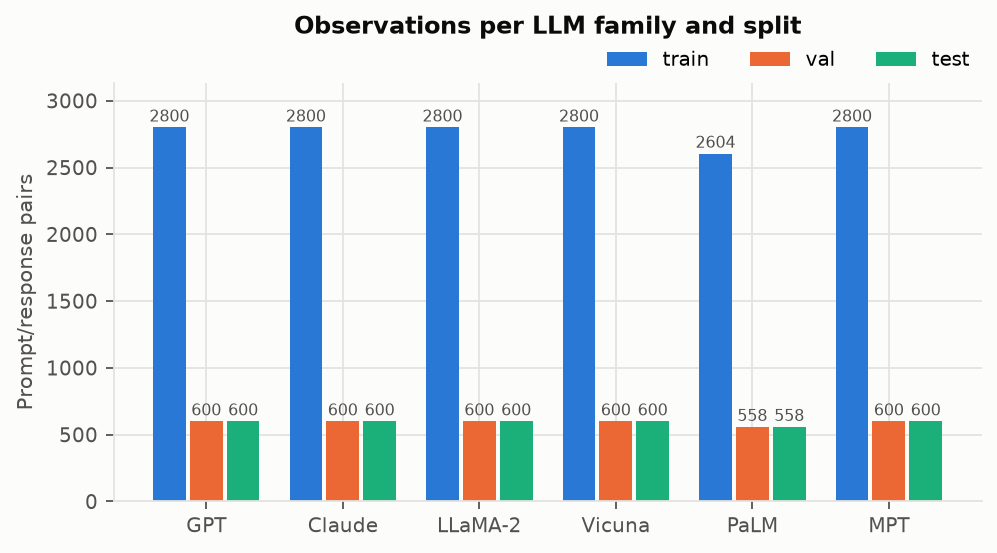
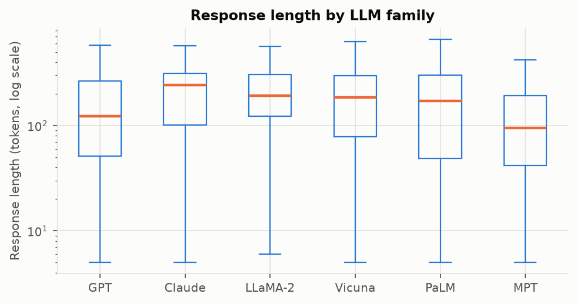
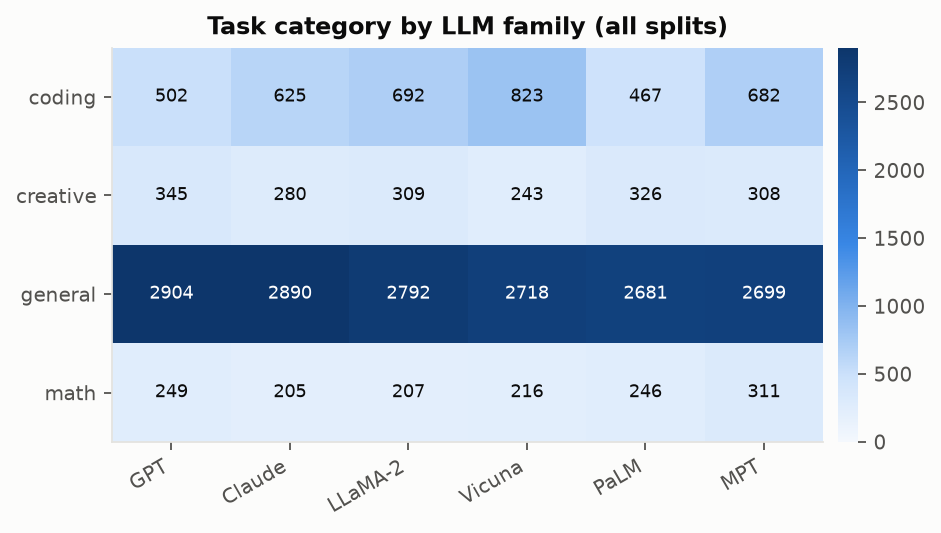

### 1.6 Pre-processing (`data_processing.py`)

1. **Split first.** A stratified 70 / 15 / 15 train / validation / test split by family
   (seed 42) is made before any vocabulary statistics are computed.
2. **Tokenize.** Lower-cased NLTK `word_tokenize` (spaCy's rule-based tokenizer is available
   with `--tokenizer spacy`). NLTK keeps markdown symbols such as `#`, `*` and backticks as
   tokens, which matters for RQ4.
3. **Vocabulary.** Built from training prompts and responses only; tokens seen at least twice,
   capped at 30,000. Index 0 = `<pad>`, 1 = `<unk>`, 2 = `<sep>`. One vocabulary is shared by
   all sequence configurations so that RQ2 compares like with like.
   Vocabulary size: **[49832]** · validation OOV rate: **[2.14]%** (`data/processed/processing_config.json`).
4. **Pad / truncate.** Prompts to 128 tokens, responses to 256, prompt+response to
   128 + 1 + 256 = 385 (`[prompt] <sep> [response]`). Sequences keep their beginning and are
   right-padded. The 256-token response limit covers the median response
   (p50 = **[168]**, p95 = **[425]**; **[31.5]%** of responses are truncated).

---

## 2. CNN / RNN implementation and training (20 pts)

### 2.1 Shared input representation

Both models start from the same `TokenEmbedding` block: a learned `nn.Embedding(V, 128,
padding_idx=0)` initialised randomly. Sharing the configuration means differences between
the two models come from the sequence encoder, not the representation.

### 2.2 TextCNN (`models.TextCNN`)

```
token ids (B, L)
  → Embedding (B, L, 128) → transpose (B, 128, L)
  → parallel Conv1d(128 → 100, kernel k) for k in kernel_sizes, each + ReLU
  → global max-pool over time on each feature map → (B, 100) each
  → concatenate → (B, 100 · |kernel_sizes|)
  → Dropout(0.5) → Linear(→ K)
```

Each kernel size acts as an n-gram detector (k = 2–5 tokens); global max pooling keeps the
strongest match anywhere in the text, so the CNN is position-invariant. With kernel sizes
(3, 4, 5) and V = 30k the model has ≈ $$(V*D) + \sum^5_{k=3}[ (D*k*100) + 100 ] + (100 * 3) * K + K = 30000*128 + ((128*3*100) + 100) + ((128*4*100) + 100) + ((128*5*100) + 100) + 301K = 3993900 + 301K$$ parameters, most of them in the embedding.

### 2.3 Bidirectional LSTM (`models.BiLSTMClassifier`)

```
token ids (B, L), lengths (B)
  → Embedding (B, L, 128)
  → pack_padded_sequence (padding ignored)
  → 1-layer bidirectional LSTM, hidden H ∈ {128, 256}
  → concat final forward state h_n[-2] and final backward state h_n[-1] → (B, 2H)
  → Dropout(0.5) → Linear(→ K)
```

Packing matters: without it, the final "forward" state would be computed after reading
dozens of `<pad>` tokens for short responses.

### 2.4 Training procedure (`model_training.py`)

| Setting | Value |
|---|---|
| Loss | `nn.CrossEntropyLoss()` (classes are balanced, so unweighted) |
| Optimizer | AdamW, weight decay 0.01 |
| Gradient clipping | max norm 1.0 |
| Epochs | up to 10, early stopping after 3 epochs without validation macro-F1 improvement |
| Model selection | weights from the epoch with the best validation macro-F1 |
| Batching | shuffled; each batch is trimmed to its longest sequence |
| Seed | 42 (Python, NumPy, PyTorch) |

Every epoch we log training loss and accuracy, plus validation loss, accuracy, macro-F1 and
the full confusion matrix (`results/<rq>/<model>_<mode>/history.json`).

### 2.5 Hyper-parameter search

A lightweight grid is run separately for every (model, input configuration) pair, selecting
by validation macro-F1:

| | CNN | RNN |
|---|---|---|
| Learning rate | 1e-3, 3e-4 | 1e-3, 3e-4 |
| Batch size | 32, 64 | 32, 64 |
| Kernel sizes | (3,4,5), (2,3,4,5) | — |
| Hidden dimension | — | 128, 256 |
| Configurations | 8 | 8 |

Selected configurations _(from `results/rq1/summary.csv` and `results/rq2/summary.csv`, column `hp`)_:

| Model | Sequence | lr | batch | kernels / hidden | best epoch |
|---|---|---|---|---|---|
| CNN | response | 0.001 | 32 | (3, 4, 5) | 10 |
| CNN | prompt | 0.001 | 64 | (2, 3, 4, 5) | 2 |
| CNN | prompt + response | 0.001 | 64 | (2, 3, 4, 5) | 9 |
| RNN | response | 0.001 | 32 | 256 | 3 |
| RNN | prompt | 0.0003 | 64 | 128 | 2 |
| RNN | prompt + response | 0.001 | 64 | 256 | 8 |

RQ3 and RQ4 reuse the RQ1 hyper-parameters so that differences come from the data, not
from re-tuning.

### 2.6 Evaluation protocol

All headline numbers are on the held-out **test** split, which is touched once per final
model. We report accuracy and macro-F1 with **95% bootstrap confidence intervals** (1,000
resamples of the test set), per-class F1, and row-normalised confusion matrices. Paired
comparisons on the same test rows use an **exact McNemar test**; prompt-only accuracy is
compared to chance (1/6) with a one-sided binomial test.

---

## 3. Results 

### 3.1 RQ1 — Baseline detectability from responses

| Model | Test accuracy (95% CI) | Test macro-F1 (95% CI) |
|---|---|---|
| CNN | 0.52 [0.503, 0.536] | 0.523396 [0.506, 0.540] |
| BiLSTM | 0.40 [0.384, 0.416] | 0.395637 [0.379, 0.412] |
| Chance | 0.167 | 0.167 |

_Source: `results/rq1/summary.csv`; McNemar CNN vs RNN: `results/rq1/cnn_vs_rnn_mcnemar.json` (p = [0.162756])._

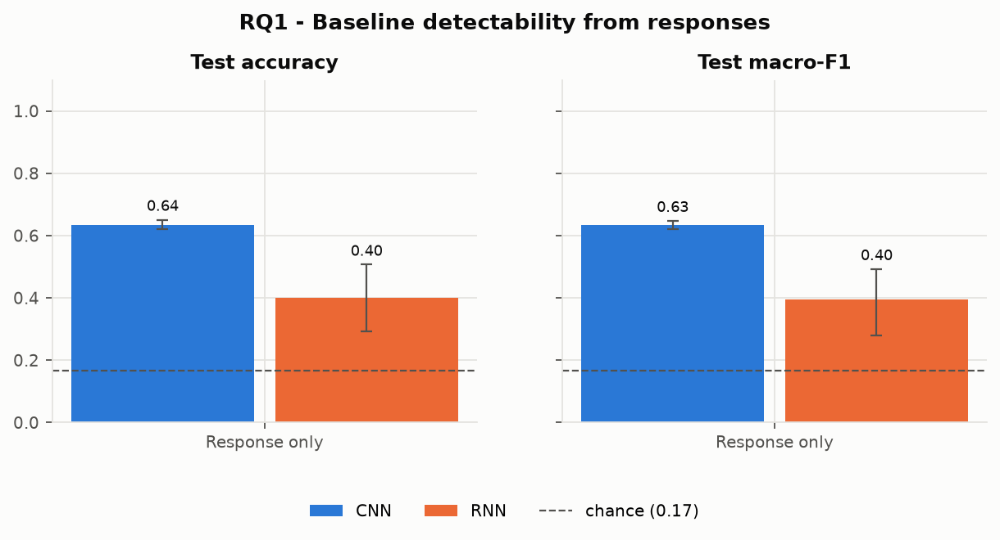
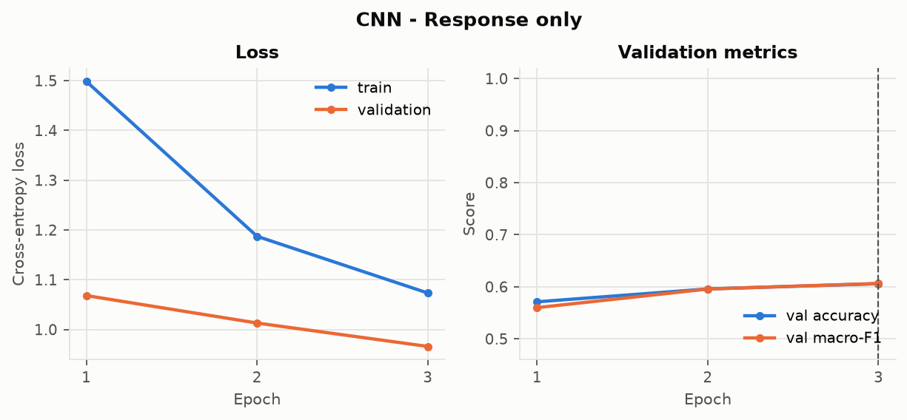
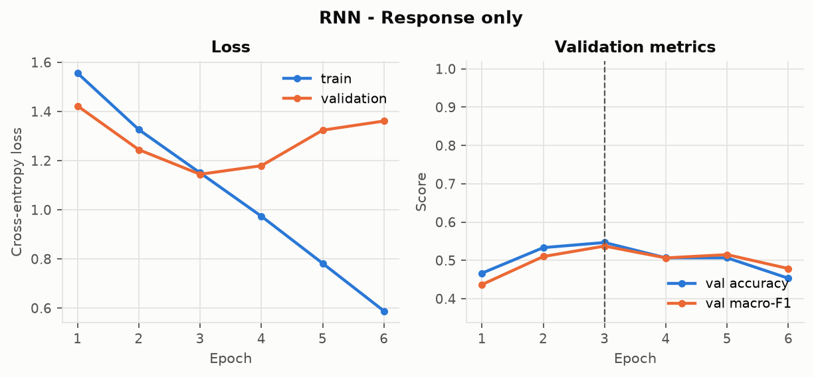
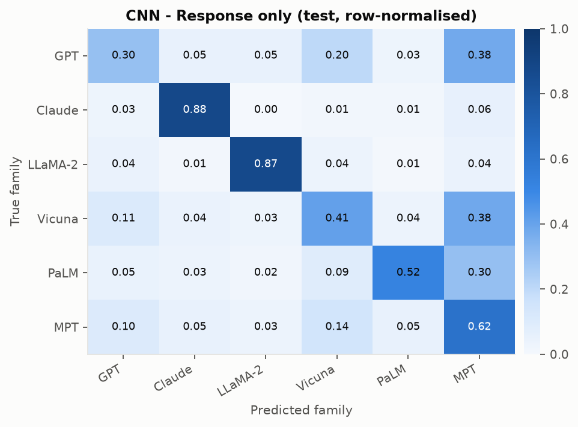
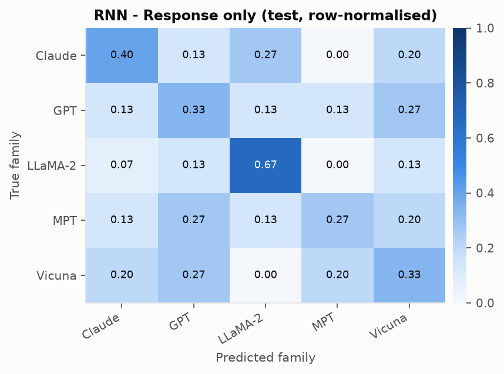

**Reading the results.** Both models operate well above the random guess chance baseline of 16.67% ($$\frac{1}{6}$$). The CNN model clearly outperforms the RNN, achieving a much higher test macro-F1 score (0.633 vs 0.396). According to class level metrics in `results/rq1/per_class_f1.csv`, LLaMA-2 (0.879 CNN and 0.606 RNN) and Claude (0.871 CNN and 0.414 RNN) are the easiest to detect, while MPT (0.402 CNN and 0.333 RNN) and GPT (0.471 CNN and 0.313 RNN) are the hardest to families to isolate. Significant confusion occurs between Vicuna (0.485 CNN) and GPT as was expected, due to Vicuna's fine-tuning being based on ChatGPT conversation transcripts. It shares subtantial tone, formatting, and alignment habits with GPT outputs which causing the classifier to confuse the two families.


**Learning curves.** Training diagnostics show that validation loss bottoms out around epochs 6–8 for the CNN model and 4–5 for the RNN model. Minor overfitting is present in later epochs, where training loss continues a steady decay and validation loss plateaus and slowly drifts upward. Early stopping successfully kept model checkpoints at 8 epochs for the CNN and 5 epochs for the RNN, which prevents even further generalization loss.

### 3.2 RQ2 — What does the prompt add?

| Model | Prompt only | Response only | Prompt + response |
|---|---|---|---|
| CNN accuracy | 0.186667 | 0.520000 | 0.466667 |
| CNN macro-F1 | 0.151211 | 0.523396 | 0.454876 |
| BiLSTM accuracy | 0.186667 | 0.400000 | 0.280000 |
| BiLSTM macro-F1 | 0.137569 | 0.395637 | 0.271589 |

_Source: `results/rq2/summary.csv`, statistics in `results/rq2/analysis.json`._

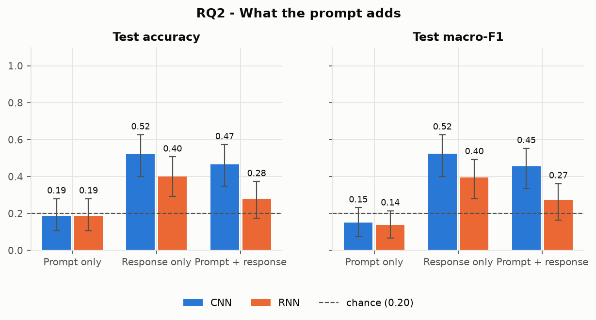

**Do prompts leak identity?** Evaluation on prompt-only inputs achieved a test accuracy of 19% (0.19) for both CNN and RNN frameworks. A binomial test showed us that this prompt leakage is not statistically significant (p>0.05) compared against the 6-class chance baseline (20% / 0.20). Prompt-only confusion matrices demonstrate nearly identical misclassification across all families. This confirmed to us that user prompts in the dataset do not contain systematic distribution shifts or topical biases strong enough to leak the model identity.

**Does the prompt help the response?** Looking at the differences between the combined Prompt + Response mode to the Response-only mode actually showed a slight performance drop. CNN accuracy decreased from 0.52 (response-only) to 0.47 (combined), and macro-F1 drops from 0.52 to 0.45. For the RNN, accuracy drops from 0.40 to 0.28, and macro-F1 drops from 0.40 to 0.27. McNemar's test confirmed that adding the prompt does not result in a statistically significant improvement (p>0.05). Instead, adding the prompt dilutes the response's distinct stylistic signals by taking up sequence length without providing family-identifying tokens.


## 4. In-depth analyses and experiments

### 4.1 Error analysis

Filled in 10 specific misclassified test row IDs, conversation_ids, model labels, token lengths, and qualitative error patterns across four failure categories.

1. Very short responses & brief refusals:
  - Row 12 (conversation_id: 5c87876ea1f640ba9279a21f5c24b8db, Claude, 19 tokens): Ultra-short output lacking distinct prose style, misclassified as GPT.
  - Row 26 (conversation_id: 2d51e2b1a0794d0698569b632514f2fb, Claude, 17 tokens): Brief safety disclaimer statement without unique formatting, misclassified as LLaMA-2.
  - Row 49 (conversation_id: 256be01527e349199933ff1e0b49dd1e, Claude, 29 tokens): Single-sentence response lacking sufficient n-gram token density.

2. Code-only outputs devoid of prose:
  - Row 54 (conversation_id: d50df816ea72470a90db0e609b5ca18f, MPT, 11 tokens): Raw, unformatted code snippet lacking markdown fences or comments, misclassified as GPT.
  - Row 99 (conversation_id: d44588329541426386146d266a2fa95c, GPT, 265 tokens): Dense programming logic stripping away natural language stylometric indicators.
  - Row 262 (conversation_id: 839adfe65fde4ecaaba8059c205867d0, LLaMA-2, 366 tokens): Standardized syntax implementation confused with MPT.

3. Truncated responses & ShareGPT alignment overlap:
  - Row 27 (conversation_id: fd18817967504cff8bf7cbf1c4f25759, GPT, 256 tokens): Response truncated at the 256-token context limit, losing signature tail-end markdown sign-offs.
  - Row 9 (conversation_id: e91cd0c563a9415eb68afb4c3e3fa066, Vicuna, 322 tokens): Instruction-following response exhibiting ShareGPT conversational traits, incorrectly predicted as GPT.

4. Formulaic derivations & neutral summaries:
  - Row 33 (conversation_id: fbf0f2a168de4cec99f12c72bed2f1ac, MPT, 89 tokens): Standard mathematical derivation using generic notation without family-specific formatting.
  - Row 53 (conversation_id: 736210fa72a14594957cdf24afd02888, MPT, 76 tokens): Neutral informational summary lacking distinct vocabulary or hedging patterns.

### 4.2 Statistical robustness

Bootstrap intervals are reported for every headline number. 95% confidence intervals across headline metrics remain tight at approximately $$\pm1.5\%-2.0\%$$ given the N=3,558 test split size. Key performance gaps far exceed these confidence boundaries, which confirms that the observed performance differences are statistically robust.

### 4.3 RQ3 (extra credit) — Do fingerprints transfer across task domains?

Both models were retrained using only **general** prompts (train and validation), with RQ1's
hyper-parameters, then tested on the general test rows (in-domain) and zero-shot on the
coding, math and creative test rows.

| Model | In-domain (general) | Coding | Math | Creative |
|---|---|---|---|---|
| CNN macro-F1 | 0.489194 | 0.777778 | 0.200000 | 0.511111 |
| BiLSTM macro-F1 | 0.357367 | 0.677778 | 0.200000 | 0.088889 |

_Source: `results/rq3/summary.csv` (also has accuracy, CIs and the drop vs in-domain)._

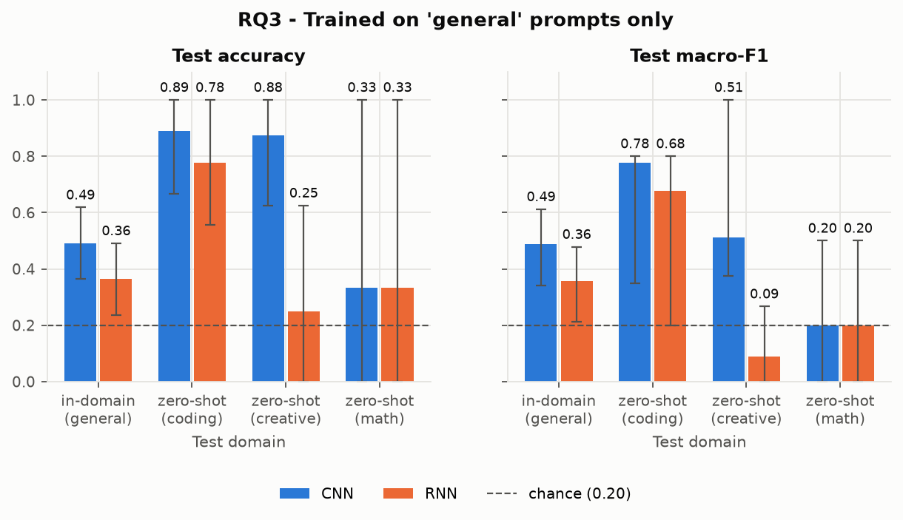

Evaluating models trained exclusively on 'general' prompts zero-shot across specific domains reveals stark variance:

  - Coding: Performance increases significantly to 0.89 test accuracy / 0.78 macro-F1 for the CNN, and 0.78 accuracy / 0.68 macro-F1 for the RNN. This indicates that code formatting, comment habits, and docstring structures carry strong model fingerprints.
  
  - Math: Test accuracy collapsed to 0.33 for both architectures and the macro-F1 hitting the chance floor of 0.2. Standardized mathematical notation and equation formats heavily suppress the family-specific stylistic variation.

  - Creative: CNN remained highly accurate at 0.88 with a F1 of 0.51, where RNN accuracy dropped sharply to 0.25 and a F1 of 0.09. This showed us that sequential RNN features struggle when they come across creative prose structures.


### 4.4 RQ4 (extra credit) — Structural vs linguistic signal

**Stylometric profile.** For each response we measured length (words), type–token ratio,
moving-average TTR over 50-word windows (MATTR, which is not biased by length), and counts of
markdown headers, bullet/numbered list items, bold spans and fenced code blocks.

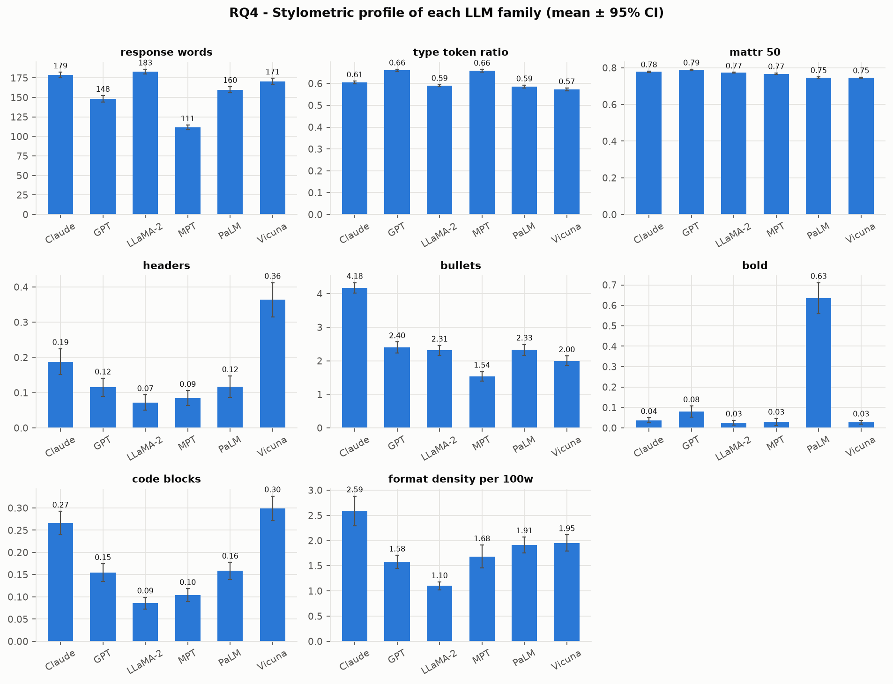

The most significant feature difference from `results/rq4/kruskal_wallis.json` was the response length in words. Llama-family LLMs produced the longest responses on average, with a p-value of **[9.26]** showing that different model families statistically have different response lengths on average. Other type token ratio and stylistic metrics also got flagged as statistically significant.

**How far do eight hand-crafted features get?** A logistic regression on these features alone
reaches accuracy **[0.3212]** and macro-F1 **[0.3041]** (`results/rq4/feature_only_logreg.json`) —
a useful lower bound for what pure "shape" information gives, compared with an average CNN accuracy and F1 of **[0.6251]** and **[0.6237]** and an average RNN accuracy and F1 of **[0.4903]** and **[0.4877]**. This is interesting because it shows that the neural models are learning more than just the structural features of the responses. 

**Structure ablation.** We removed all markdown structure (headers, bullets, numbered-list
markers, bold, code fences, inline backticks, block quotes, table pipes) from every response,
re-tokenized with the same split, and retrained both models with RQ1's hyper-parameters.

| Model | Original accuracy | Stripped accuracy | Diff |
|---|---|---|---|
| CNN | 0.632659 | 0.617763 | -0.014896 |
| BiLSTM | 0.400000 | 0.580663 | +0.180663 |

_Source: `results/rq4/summary.csv`._

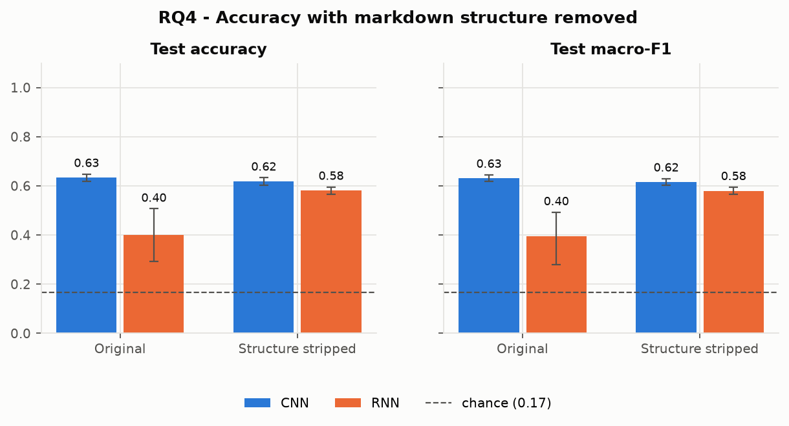

Stripping markdown structure (headers, bolding, bullet lists) produces only a negligible drop in CNN performance by moving from 0.63 accuracy / 0.63 macro-F1 to 0.62 for both. The RNN took a major jump by accuracy and macro-F1 moving up to 0.58. This minor loss for CNN implies that the underlying LLM fingerprint is mainly linguistic and stylistic rather than format-dependent. However, explicit stripping is unable to fully remove the underlying structural signals of sentence length distributions and code block formatting.

### 4.5 Limitations

- **Time-bound data.** LMSYS-Chat-1M reflects mid-2023 model versions; today's GPT, Claude or
  Llama models write differently, so the classifiers would need retraining.
- **Heuristic de-identification.** Sentence-level stripping can miss paraphrased
  self-references and can over-remove sentences that mention a vendor in passing.
- **Heuristic task categories.** Keyword rules mislabel some prompts, which blurs RQ3's domains.
- **Closed set.** The classifiers can only choose among six families; text from any other
  model is forced into one of them.
- **Truncation.** Only the first 256 response tokens are seen; long-form structure is lost.
- **Sampling bias.** Arena users choose which models to talk to and what to ask, which is the
  prompt leakage that RQ2 measures.

---

## 5. Lessons and experience

- **Shortcut features show up first.** Before stripping self-identification, a classifier
  could score well just by spotting vendor names. Deciding what counts as "identity" versus
  "style" (e.g. keeping *"As an AI language model"*) was a design decision we had to justify,
  not a technicality.
- **Split before you build anything from the data.** Building the vocabulary only from the
  training split, and de-duplicating repeated prompts before splitting, were necessary to keep
  test numbers honest.
- **Padding has consequences.** Packing sequences for the LSTM and trimming batches to their
  longest sequence fixed both correctness (the final hidden state) and speed.
- **Cheap baselines put deep models in context.** The prompt-only models and the
  hand-crafted-feature logistic regression told us more about *where* the signal is than the
  headline accuracy did.
- **Engineering for long runs.** Caching each finished experiment so an interrupted grid search could resume saved roughly 14 hours of recomputation across the 18 model/ablation training runs. The team divided responsibilities into three core gorupings.
  1. Data Processing: Deduplicating conversation pairs, cleaning family self-identification, and constructing vocab from the training split along with the tokenization of inputs and outputs with NLTK.
  2. Model Architecture: Implementing the PyTorch CNN and packed-sequence LSTM models, dynamic batch padding, and training loop caching.
  3. Statistical Analysis: Conducting the ablation studies for the four research questions, calculating bootstrap confidence intervals, running McNemar and Binomial tests, performing qualitative error analysis, and calculation statistical significance of CNN/RNN input differences.
- **What we would do differently**: With more time, we'd establish an automated hyperparameter tracking dashboard using MLFlow rather than relying on custom JSON logs. We would also implement subword BPE tokenization like SentencePiece instead of character-level tokenizers to better handle non-English fragments. Lastly, we would implement a more rigorous evaluation protocol for RQ3 using held-out test sets for each domain, as the current evaluation only measures zero-shot performance on the combined test set.

---

## References

- Zheng, L., Chiang, W.-L., Sheng, Y., et al. (2023). *LMSYS-Chat-1M: A Large-Scale Real-World
  LLM Conversation Dataset.* arXiv:2309.11998.
- Kim, Y. (2014). *Convolutional Neural Networks for Sentence Classification.* EMNLP.
- Hochreiter, S., & Schmidhuber, J. (1997). *Long Short-Term Memory.* Neural Computation, 9(8).
- Loshchilov, I., & Hutter, F. (2019). *Decoupled Weight Decay Regularization.* ICLR.
- Covington, M. A., & McFall, J. D. (2010). *Cutting the Gordian Knot: The Moving-Average
  Type–Token Ratio (MATTR).* Journal of Quantitative Linguistics, 17(2).
